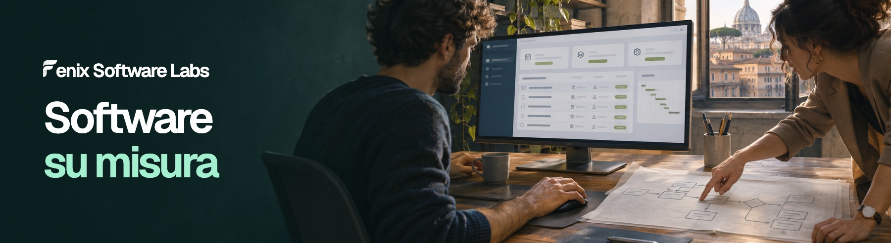

# Fenix Software Labs

Siamo una **software house di Roma**. Progettiamo e sviluppiamo software su misura per le aziende. Realizziamo applicazioni web e mobile, gestionali e integrazioni tra gli strumenti che le persone usano ogni giorno.

Partiamo da chi farà il lavoro. Se un ordine passa dal commerciale al magazzino attraverso email e fogli di calcolo, ricostruiamo quei passaggi insieme ai due reparti. Su questa base progettiamo il flusso, sviluppiamo l’applicazione e la colleghiamo ai sistemi già in uso. [Parlaci del tuo progetto](https://fenixsoftwarelabs.com/contact)

## I nostri prodotti

Con l’email di lavoro, ogni persona ritrova nell’app ByFenix i servizi attivati dalla propria azienda, dal computer o in mobilità. [Scopri ByFenix](https://byfenix.it/)

Ceramic Studio permette di accostare sanitari, materiali e finiture nella stessa stanza in 3D. Durante una consulenza in showroom, il cliente può confrontare due varianti e vedere come cambia l’intero ambiente. [Esplora Ceramic Studio](https://byfenix.it/ceramic-studio/)

---

[Sito di Fenix Software Labs](https://fenixsoftwarelabs.com/) · [Contatta lo studio](https://fenixsoftwarelabs.com/contact)
